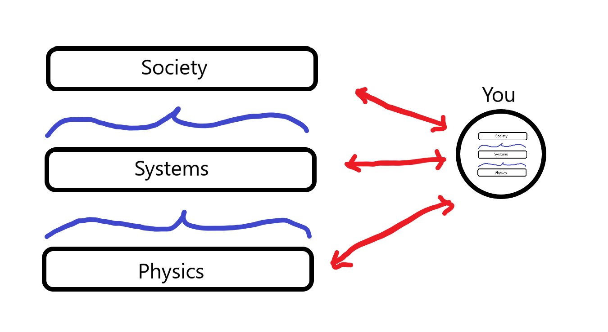
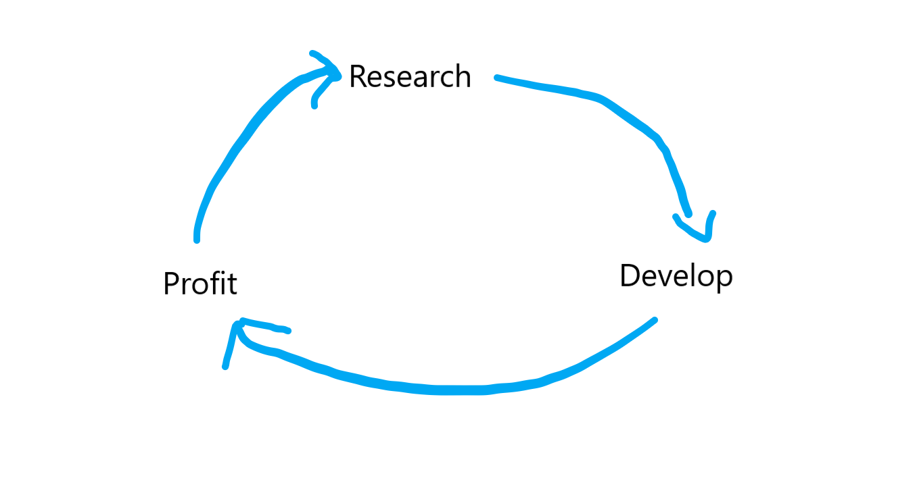

# 🗻 Going Deeper
*James K. Wiles | 2024-02-03*

Re-examining your axiomatic beliefs and the benefit of developing more fundamental principles.

We all operate under some axiomatic system of foundational beliefs. To some of us these inherent ideas rub off automatically as social norms and ways of doing things simply because “that’s what people do”, but to more divergent thinkers an explicit framework is very necessary to operate in the world.

As someone who has naturally had to think from first principles in order to make almost any decision in life, the framework of axioms upon which I have scaffolded my decision making framework is very important. Recently I have come arrived at an opportunity to re-evaluate my fundamental beliefs and have carefully considered what could be a more effective and useful set of axiomatic beliefs. This undertaking is not to be taken lightly because messing with the foundations that have established your entire world-view is momentarily destabilizing, and without due care to re-establish good anchors you could find yourself adrift with no way back to a functional state.

When I read Rich Dad Poor Dad by Robert Kiyosaki I woke up the next day with enthusiasm to try out my new framework for thinking about the world. Later in life, I meditated on the drive of making money and if this could be rather be replaced with the motivation of doing good. I woke up the day after completely drained of the will to get out of bed. I quickly realized that I had replaced a foundational concept for every action I had taken in life up until that point and experimented with replacing be formative idea of making money with a less concrete concept of doing good, with very little regard for the implications that such a deep shift in my mental architecture could create. I quickly hit the undo button in mind, and said to myself: “go back to making money, then revisit this idea once you have developed the mental scaffolding to support such a heavy set of ideas”, and with this little system reboot I managed to jump out of bed and get along my day activities again.

In the midst of a career transition and with the accumulated experience of operating under an certain set of ideas for more then 10 years, I now have the space to sketch out, experiment with and hopefully construct some new ideas to better serve my ambitions. To do so I will first unearth and survey my current axioms, and then try to create deeper ones that can hopefully explain why the pros of those previous ideas worked and how the cons where hidden from me from for so long.

# Old Ideas

Here is a list of some axioms I was explicitly operating under. Is it possible to derive these principles from from more foundational ones?

- Be a good person
- Try your best at whatever you do
- Live without regret
- Do what you want
    - what you want has tradeoffs depending time horizon of desires, e.g. party and drink tonight, or stay sober to get work done tomorrow without a hangover?
- Follow your curiosity
    - when and how do you start turning your interesting discoveries into profitable activities?
- Make money doing things that motivate you
    - what if it is the making money that is what motivates me?
- Make money first then, then have do you want
    - You may notice this is in direct contradiction to my “Do what you want” principle
- Economic Karma - if you create value for people, the universe will act to reward you with value in return
    - as naive as this sounds it helped me form my minimal motto of just “add value”, which helped me make most my decisions for the last 14 years, but is **severely** prone to exploitation
    - the repercussions of operating under this principle for long enough has resulted in the desire the investigate deeper, better principle to live life by

# New Ideas

## The Three Levels

There are three layers of existence that are helpful strata to construct ideas and frameworks at. Each are connected on top of one another, but the precise connections are potentially irreducibly complex, and could represent phase shifts of new emergence phenomena that introduce new concepts to reason about. In ascending order of abstraction: Physics → Systems → Society

| **Society**  | Systems      | Physics     |
| ------------ | ------------ | ----------- |
| Humanities   | Complexity   | Mathematics |
| Evolution    | Emergence    | Formalisms  |
| Psychology   | Intelligence | Axioms      |
| Neuroscience | Biology      | Science     |
| Philosophy   | Entropy      |             |
|              | Life         |             |

## Where You Fit In

The concept of “you” is the observer with which observations and interactions at any level happens. Wherever you draw the boundary of the observer or agent with respect to it’s environment is the separation that allows you to describe a system, whether it is as a physics, systems or societal level. However we most often think of “you” at a human level where you exist in society, and this is where most peoples cognitive decision making takes place. Applying the reasoning of “you” in relation to the concepts at lower strata can give you new abilities to make decisions from more fundamentally valid principles.

## The Virtuous Cycle

A cycle creates a helpful structure to think about what today over time, as any one strategy could be good or bad depending on the current environment the evolves over time and is itself affected by your actions. By thinking in terms of where you and the environment is in the cycle, you can establish how to evolve and adapt your strategy to make progress.

Some alternative descriptions and contexts of this cycle:
Investigate → Develop → Profit → …
Explore → Construct → Agree → …
Research → Technical Advance → Market Acceptance → …
Discovery → Action → Consumption → …

## New Axioms

A good individual statement answers both “what to do?” and “how to do it?” questions. It can then also be compressed into a minimal motto that can be applied to every decision that you need to make, reasoning upwards to higher abstractions when necessary.

### Old statement:

_“Do the most good,_
_with money made,_
_by adding value.”_
- requires a two step process, first make money then do good, which are not necessarily synergist

### Old motto:

_“just add value”_
- not applicable to every situation: e.g. when watching YouTube it is difficult to think about how to add value when consuming content, or which video to watch next.

### New statement:

_“Bring the future forward,_
_that helps humanity the most,_
_which we can agree on.”_
- This three line statement relates to each step of the virtuous cycle: Exploration → Development → Agreement

### New motto:

_“create gravity”_
- Can be applied to all three levels of existence:
    - **Societal** implications:
        - the gravity of what you say
        - the gravitas of you presence
        - your attractiveness as person
    - **Systems** considerations:
        - concentration of energy with focus amidst distractions
        - the flow of energy between agents and their environment
        - the relationship between universal low and high entropy states
    - **Physics** foundations (but at this strata is more like _“harnessing gravity”_:
        - interactions between unknown, known, and contradiction
        - relationships between energy, time, and observers
        - everything is connected
- creating gravity resolves the content consumption quandary because now I can think about what to consume as what generates consistency between patterns of ideas in your mind, leading to solidification of concepts.

## Turing previous axioms into theorems

Armed with set of new axiomatic belief I can start experimenting with my daily decision making habits, observations of the world, and re-examine all my principles to see if they are derivable.

Starting with dissecting my Economic Karma principle.

Just adding value everywhere for whoever I can whenever I see an opportunity to do so, resulted in me applying myself thinly in all over the place and saying “yes” way more then I should have.

Thinking in terms of what adds gravity, consistency, and concentration of energy, I can now more easily justify reasons to say no to things that distract and diffuse my focus in core directions. Working on things that compound your efforts is an idea I was working with before, but now the importance is connected at much deeper level is more foundational to my reasoning process.

The concept of adding value is now firmly placed in the strata of societal concerns the definitions of value can be thought of in the context of the other topics at that level, but now with the awareness that it is construction of deeper ideas in agent based models, and game theory from the systems strata, and even deeper ideas in the realm of energy, entropy, time at the physics level.

I know have a much richer framework with which to evaluate decisions if necessary, but at the same time have a simple motto that applies at all levels… “create gravity”.

## Conclusion:

~ Going deeper has trade-offs - timing, frequency, cost, stability etc.

Parting thought:

A story based ideas can be re-examined and refined. We are not dealing with the laws of physics here, better compression algorithms and optimized narrative impact is always incrementally possible. Adjusting to societal movement by evolving these ideas to fit the environment is also an always-on requirement.
