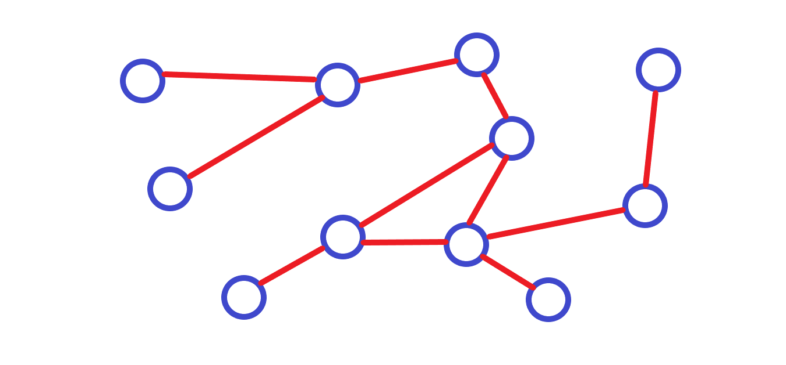

# 🔗 We are not the nodes, we are the relationships
*James K. Wiles | 2021-08-04*

> “Invert, always invert.” - Charlie Munger

The most fundamental system components are represented by nodes and edges. A logical analogy to humanity is that the nodes represent people and the edges (or connections) represent the relationships between the people. However, profundity begins when we think about the inverse. Perhaps "we" _are_ the relationships.

This type of thinking was is a favourite of Charlie Munger, who got this concept from the mathematician Carl Jacobi. He captures this concept in the following quote:

> “Invert, always invert: Turn a situation or problem upside down. Look at it backward. What happens if all our plans go wrong? Where don’t we want to go, and how do you get there? Instead of looking for success, make a list of how to fail instead. Tell me where I’m going to die, that is, so I don’t go there.” -  Charlie Munger

Knowing where you will die limits your maximum downside risk and is the first step to being able to benefit from the chaos of life. An unexpected event can kill you, but if you know what can kill you and have plan to deal with it, then every unexpected event does not become an existential crises that requires all your attention. Then you can start to regard these inevitably unpredictable events as potential sources of opportunity for progress. The focus first on where you don't want to be at all costs is the inversion of where you do want to be no matter what. This is a healthy thinking exercise for business, strategy, and life in general because without this consideration you will be stuck with your head in the clouds.

Inverting the concept of what a system lets you consider things with a new angle of light that takes the attention off the objects themselves and lets you see the connections as perhaps the more important thing. If we are what we think we are, and we are in our brains, then are we a collection of neurons connected arbitrarily _or_ are we the pattern of relationships embodied in arbitrary neural matter. With the power exhibited by artificial intelligence that uses neural network based machine learning we certainly can demonstrate a case for the ability to upload our brains to a digital medium.

The concept of inversion is to shift the attention front to back in the hope that this illuminates something to help solve a problem you where thinking about, but ultimately this is just a method to see the challenge from different angles so as to overcome it. What is revealed if you apply this technique to the representation of our society as a system?

You are, perhaps, not an individual person with a network of friends, family, and colleagues but are rather the individual pattern of relationships that happens to be identifiable as a unique person.
